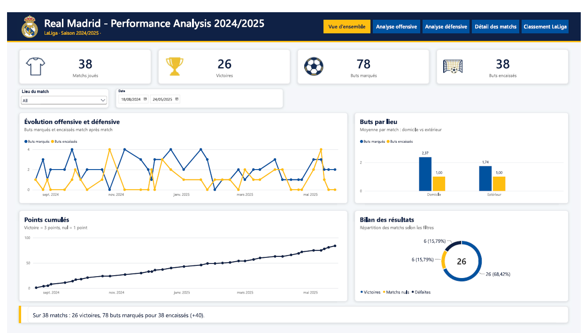
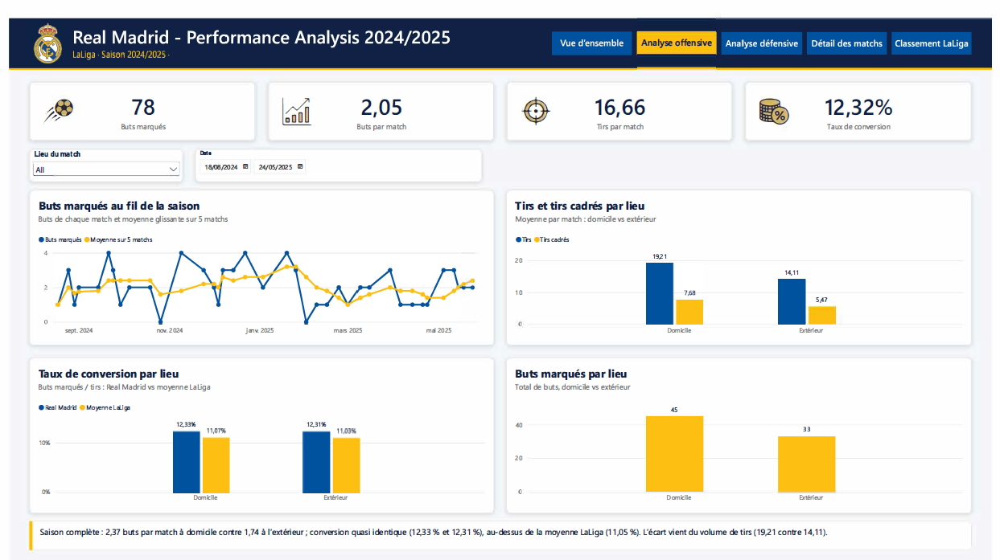
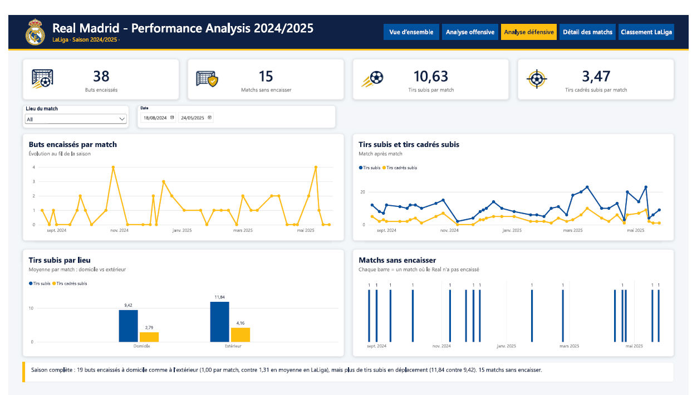
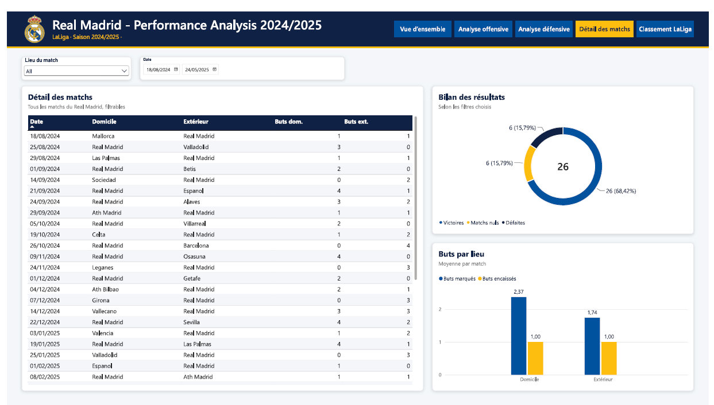
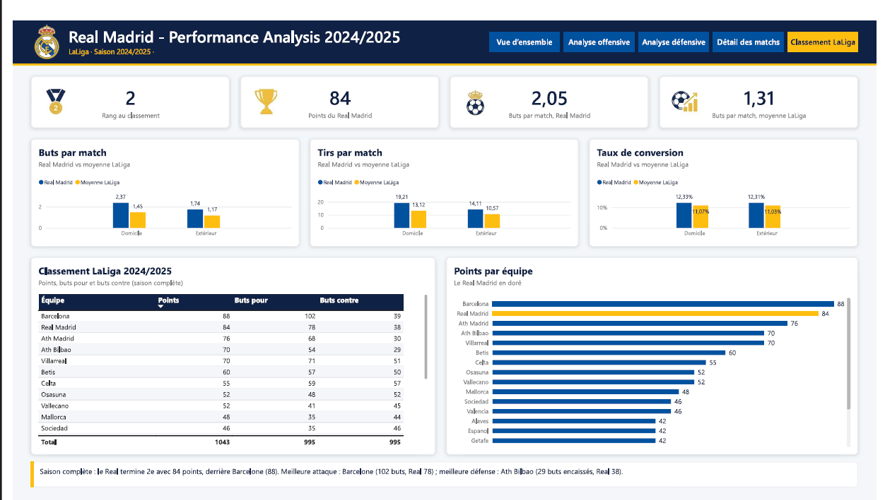

# Real Madrid - Performance Analysis 2024/2025

Dashboard Power BI consacré à la saison 2024/2025 du Real Madrid en Liga. Le projet analyse les performances de l'équipe sous différents angles : résultats, attaque, défense et comparaison avec les autres clubs du championnat.

Le rapport comporte cinq pages interactives, avec des filtres sur le lieu du match et la période, synchronisés entre les pages.

## Contenu du projet

| Fichier | Description |
|---|---|
| `Real_Madrid_Performance_2024_2025.pbix` | Rapport Power BI |
| `Documentation_KPI.md` | Définition des indicateurs et méthodes de calcul |
| `Real_Madrid_Dashboard.pdf` | Export PDF du dashboard
| `images/` | Captures d'écran du dashboard |

## Pages du dashboard

### 1. Vue d'ensemble

Synthèse de la saison : nombre de matchs, victoires, buts marqués et encaissés, évolution des résultats et performances à domicile et à l'extérieur.

### 2. Analyse offensive

Analyse de la production offensive : buts marqués, tirs, tirs cadrés et taux de conversion. Comparaison des performances à domicile et à l'extérieur.

### 3. Analyse défensive

Analyse des buts encaissés, des matchs sans encaisser, des tirs et tirs cadrés concédés, avec une comparaison entre les matchs à domicile et à l'extérieur.

### 4. Détail des matchs

Tableau des 38 matchs de Liga avec les dates, les équipes, les scores et les résultats. Les filtres permettent d'explorer les rencontres selon différents critères.

### 5. Classement LaLiga

Comparaison du Real Madrid avec les autres équipes du championnat : classement, points, buts, tirs et taux de conversion. La page inclut également un benchmark par rapport aux moyennes de LaLiga.

## Résultats clés

| Indicateur | Résultat |
|---|---:|
| Matchs joués | 38 |
| Victoires | 26 |
| Matchs nuls | 6 |
| Défaites | 6 |
| Taux de victoire | 68,42 % |
| Buts marqués | 78 |
| Buts encaissés | 38 |
| Matchs sans encaisser | 15 |
| Classement final | 2e |
| Points | 84 |

**Domicile et extérieur :**
- Domicile : 2,37 buts par match et 19,21 tirs en moyenne.
- Extérieur : 1,74 buts par match et 14,11 tirs en moyenne.
- Taux de conversion : environ 12,3 % dans les deux cas.

## Modèle de données

Le modèle repose sur deux tables indépendantes :

- `Real_Madrid_2024_2025` : les 38 matchs du Real Madrid.
- `LaLiga_Equipes` : 760 lignes correspondant aux performances des 20 équipes sur les matchs du championnat.

Des colonnes calculées permettent notamment de distinguer les matchs à domicile et à l'extérieur et de ramener les statistiques au point de vue du Real Madrid.

Les mesures DAX servent à calculer les résultats, les points, les moyennes, les taux de conversion, les matchs sans encaisser et les comparaisons avec le championnat.

## Outils utilisés

- **Power BI Desktop** : création du dashboard et des visualisations.
- **Power Query** : préparation et transformation des données.
- **DAX** : création des mesures et indicateurs.
- **GitHub** : gestion et partage du projet.

## Utilisation

1. Télécharger le fichier `.pbix`.
2. Ouvrir le rapport avec Power BI Desktop.

Palette utilisée :
- Bleu marine : `#0F2145`
- Bleu royal : `#00529F`
- Doré : `#FEBE10`
- Fond : `#F5F6FA`

## Limites de l'analyse

L'étude porte uniquement sur la saison 2024/2025. 

## Avertissement

Projet personnel réalisé pour mon portfolio, sans affiliation ni partenariat avec le Real Madrid CF.

## Source des données

[Football-Data.co.uk](https://www.football-data.co.uk/). championnat espagnol, saison 2024/2025.
